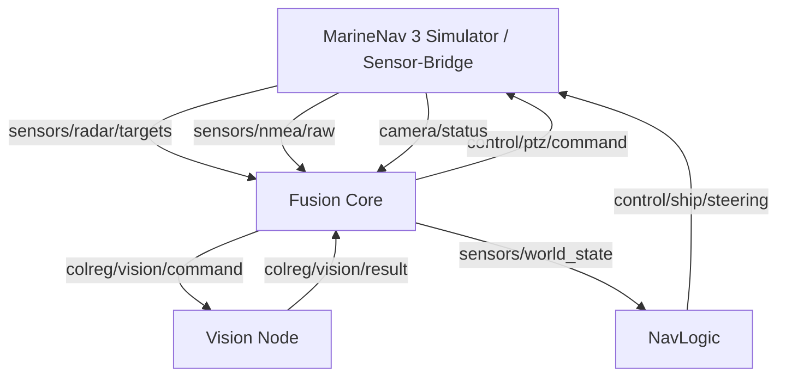

# MarineNav 3: Автономная система навигации MVP

## ⚓ Миссия проекта
MarineNav 3 — это модульный прототип автономной системы навигации для судов (ASV), полностью соответствующий международным правилам предупреждения столкновений судов в море (**МППСС-72**). 

Система построена на базе децентрализованной архитектуры через **MQTT**, что позволяет объединять компьютерное зрение, слияние данных датчиков и автономное принятие решений в единый контур.

---

## 🏗️ Архитектура системы



### Основные модули:
1.  **Sensor-Bridge**: Эмулятор окружения, GPS, радара и PTZ-камеры. Включает движок "Infinite Ocean" для процедурной генерации трафика.
2.  **Vision Node (cv-core)**: Нейросетевой модуль (YOLO) для классификации судов и сигналов МППСС (дневные фигуры/ночные огни).
3.  **Fusion Core**: Слой восприятия (Perception). Объединяет данные радара и CV, управляет умным наведением камеры (Smart PTZ) и транслирует очищенную "картину мира" (`world_state`).
4.  **NavLogic**: "Мозг" системы (в разработке). Отвечает за соблюдение правил МППСС и планирование безопасных маневров уклонения.

---

## 🛰️ MQTT API (Контракт)

### 1. Выход Perception (Fusion Core -> NavLogic)
**Топик:** `sensors/world_state`
```json
{
  "own_ship": { "lat": 64.6, "lon": 39.5, "course": 45.0, "speed": 10.0 },
  "tracked_targets": [
    {
      "id": "CH_001",
      "bearing": 12.5,
      "distance": 2.1,
      "course": 180.0,
      "speed": 15.0,
      "cpa_nm": 0.5,
      "tcpa_minutes": 10.2,
      "cv_class": "sailing", 
      "cv_confidence": 0.95
    }
  ],
  "environment": { "is_fog": false, "is_night": false }
}
```

### 2. Вход Control (NavLogic -> Simulator)
**Топик:** `control/ship/steering`
```json
{ "action": "set_course", "value": 115.0 }
{ "action": "set_speed", "value": 12.0 }
```

---

## 🚀 Быстрый старт (Zero-Config)

1.  **Требования**:
    - Python 3.10+
    - Docker Desktop (для MQTT брокера)
2.  **Запуск**:
    - Просто запустите файл **`start.bat`**.
    - Скрипт сам создаст виртуальное окружение, установит зависимости, поднимет Docker-контейнер и запустит все сервисы.
3.  **Веб-интерфейс**:
    - Панель управления откроется автоматически по адресу: `http://localhost:8001`
    - Нажмите кнопку **🌪️ Chaos**, чтобы запустить процедурный трафик в Белом море.
4.  **Разработка NavLogic**:
    - Ваш рабочий код находится в папке `/nav-logic`.
    - Для тестирования изменений достаточно перезапустить консоль с NavLogic.

---
**Разработано для MarineNav-MVP**
